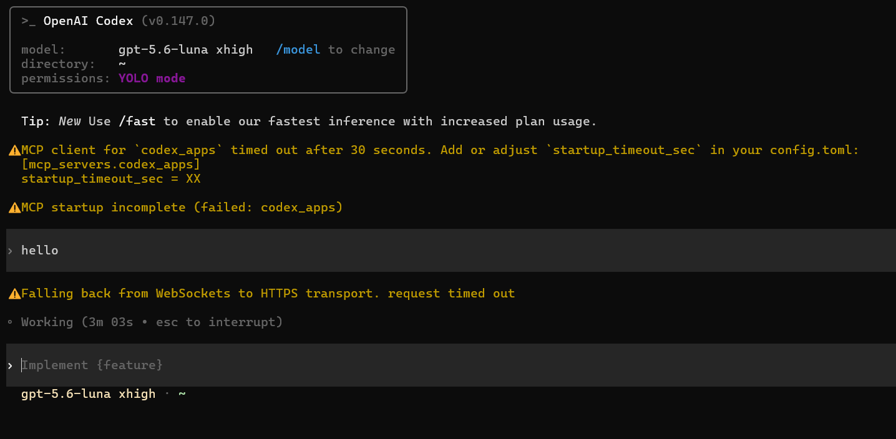
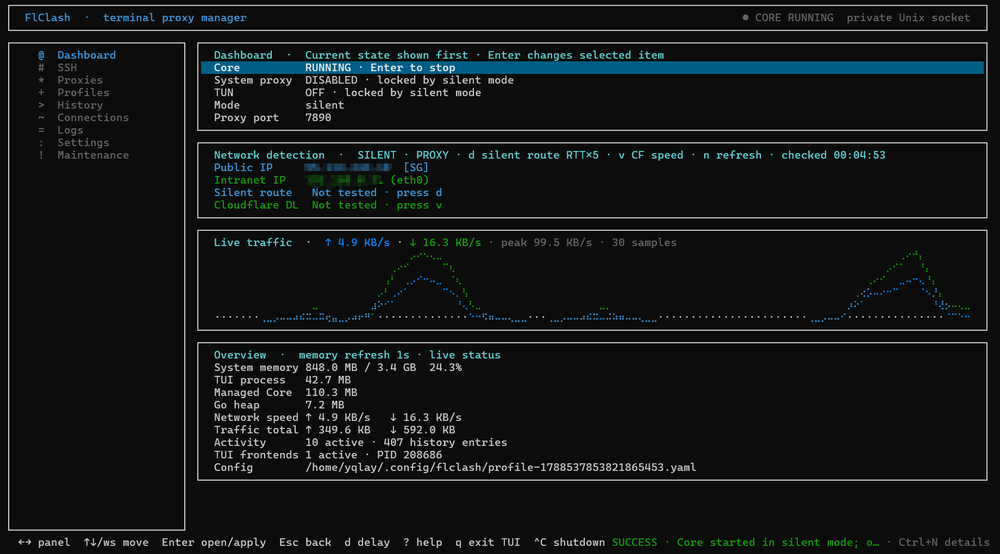
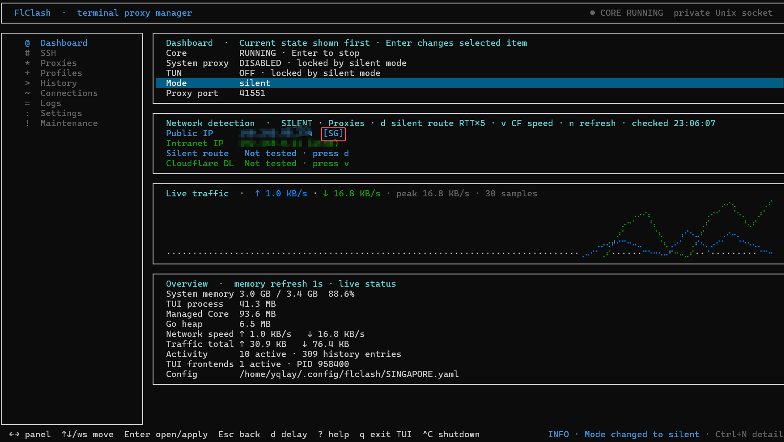
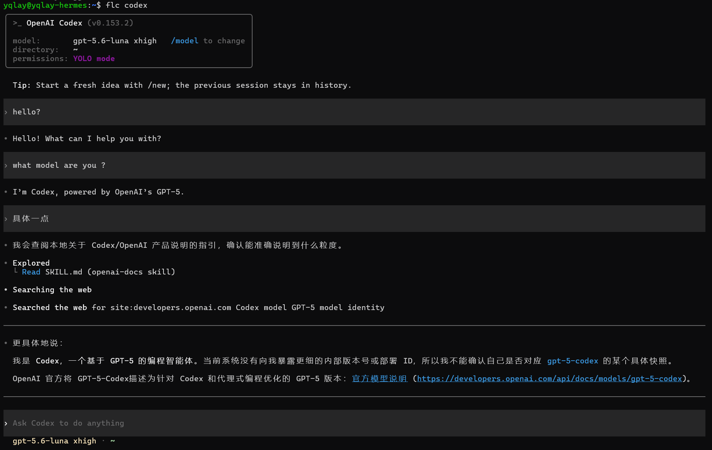
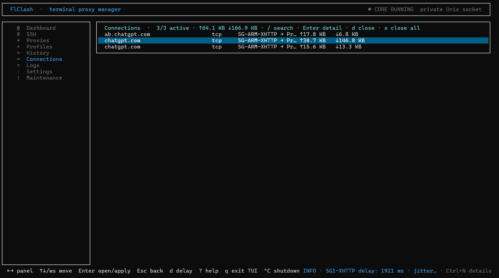

# FlClash TUI

[中文首页](README.md) · [Full documentation](CLI_LINUX.md) · [Releases](https://github.com/yqlay/flclash-tui/releases)

[](https://github.com/yqlay/flclash-tui/releases)
[](https://github.com/yqlay/flclash-tui/releases)
[](LICENSE)

A Mihomo terminal manager for Linux, SSH, and headless hosts. Run `flclash` for the full-screen TUI. The default mode is **silent**: only `flc COMMAND` uses the proxy.

The TUI defaults to English. In **Settings → Language**, use ↑↓ to highlight, Enter to save and switch immediately, or Esc to cancel. There are 18 language choices, including Simplified/Traditional Chinese and Nigerian Pidgin. Translations are drafts; complex scripts require terminal/font support. **Language / English stays accessible**. Commands and logs remain in English.

## Can't run Codex / Claude on headless Linux? One `flc` is enough

On many networks, installing Codex or even running `codex` directly just fails.

That looks like this:

<p align="center">
  
</p>

Hand-writing proxy env vars is messy. FlClash TUI's path for headless Linux is direct: import a subscription, pick a node, then start the command with `flc`.

## Who it is for

- Remote Linux, cloud VMs, lab machines, or WSL, with a subscription already in hand;
- Proxying only chosen commands such as Codex, Claude, git, or npm;
- Leaving other services, containers, and SSH sessions on the machine alone;
- Failing closed when the listener, Core, or node is down, instead of silently going direct.

## Step 1: Install before you have a proxy

```bash
curl -fsSL https://raw.githubusercontent.com/yqlay/flclash-tui/main/install.sh | bash
```

Force a portable installation:

```bash
curl -fsSL https://raw.githubusercontent.com/yqlay/flclash-tui/main/install.sh | bash -s -- --method portable
```

If GitHub is unstable, download the matching `.deb` or `.tar.gz` from [Releases](https://github.com/yqlay/flclash-tui/releases), copy it over, then `sudo dpkg -i`. Do not pin a version string; always use the latest Release.

Use `flclash update --check` to check for updates. For `.deb` installations, run `flclash update` and confirm; for portable installations, rerun the portable installer above. Upgrades preserve profiles, SSH settings, and the language preference. Reopen the TUI afterwards.

The first half is the TUI. The same jobs as shell commands are in **Command line** below.

## TUI

### Import a subscription and pick a node

Run `flclash` to open the TUI. In **Profiles**, import a subscription URL or local file, select it, and press Enter to activate. Then in **Proxies** pick a group and node (press `d` to test delay). Dashboard should stay on `silent` so other programs are left alone. Focus **Core** and press Enter to start it. Other modes also need **System proxy**.

<p align="center">
  
</p>

<p align="center">
  
</p>

Headless hosts default to `silent`: system proxy and TUN stay off, and only commands you prefix with `flc` use the proxy.

When the subscription provider supplies usage metadata, **Profiles** shows used traffic, quota, and expiry. Local files or subscriptions without that metadata remain unknown; the app does not guess quotas. Silent mode does not expose a port on the LAN or the public internet.

To send one command through the proxy, use `flc` in the command-line half below. After `flc codex` connects:

<p align="center">
  
</p>

The Dashboard traffic graph updates. **Connections** lists proxied and SSH reverse-proxy sessions (`f` switches proxy / ssh, `/` searches, Enter opens details, `d` closes the selected flow, `x` closes every flow in the selected source). **History** uses `/` to search, `f` for all / active / completed, `o` for the source, and `x` to clear that source's history. **Logs** uses `/` to search, `f` to filter levels, Enter for the full record, `e` to export, and `x` to clear. Closing a flow does not erase history.

<p align="center">
  
</p>

### Desktop / system-wide proxy

To send ordinary apps such as a browser through the proxy, switch Dashboard mode to `rule` or `global`, then enable **System proxy** or TUN. On headless hosts, prefer `flc` in the command-line half.

### SSH

Open the TUI on the machine whose traffic needs a proxy. On the **SSH** page, ↑↓ only moves the highlight, Enter connects or disconnects, `u` stars the default, `e` edits, and `x` deletes. The first row is **Capture**. Enter or `a` attaches a SOCKS listener already on this machine and does not open a new login. A plain interactive `ssh` without ControlMaster, `-D`, or `-R` does not appear.

Speed and the traffic graph count only that tunnel's local forwarding. Dashboard counts Mihomo Core separately. A connected profile can be inspected, but disconnect it before saving edits. Detail views use PgUp/PgDn. Public IP is checked at startup, after the route changes, or on a manual refresh. Delay and speed run only when you ask, and a route change drops the old result. If a settings draft conflicts, note the values you want, press Esc, then uppercase `R` to reload. `?` lists keys. `Ctrl+N` opens notifications. `q` leaves the screen and cancels an unfinished connect. A tunnel that is already up stays up.

### SSH reverse proxy

B is the machine whose programs need a proxy. A is the machine that already has internet and has FlClash TUN enabled.

On A's TUI, set the mode to `rule` or `global` and turn TUN on. Then in a terminal on A:

```bash
ssh -f -N -R 10808 -p PORT USER@B
```

Do not add `LD_PRELOAD`. Connections from B return to the ssh process on A. TUN sends that user's outbound traffic into Clash, which splits it with A's rules. Addresses matched to direct (for example `172.16.0.0/12`) are not proxied, so this SSH session can reach B.

On B, select **Capture** on the **SSH** page and press Enter. The list should show `INBOUND`. The SOCKS port on B is `127.0.0.1:10808`, and traffic leaves through A under A's rules. `ssh -D` listens on A's own `127.0.0.1`; capture that in A's TUI. B cannot see it.

### Exit

`Ctrl+C` stops this user's frontends, Backend, Core, and SSH. `q`, or closing that terminal, leaves only the screen. The Backend stays up.

## Command line

`flc COMMAND` sets uppercase and lowercase `HTTP_PROXY`, `HTTPS_PROXY`, and `ALL_PROXY` for that command only, and for children of `flc bash`. If the listener, Core, or node is down, `flc` errors and refuses to run instead of going direct.

```bash
flc example_command
flc sudo -E example_command          # -E keeps the proxy variables under sudo
flc codex
flc claude
flc git clone https://github.com/owner/repository.git
flc npm install
flc curl https://example.com
flc sh -c 'git fetch --all && npm ci'
flc bash                             # children inherit the proxy; the variables disappear on exit
```

Other shells, system services, Docker containers, and existing connections are untouched.

```bash
flclash ssh import                   # import Host entries from ~/.ssh/config
flclash ssh add home host --user user --password --local-port 1080
flclash ssh default home
flclash ssh attach --list
flclash ssh attach                   # capture a live ControlMaster, ssh -D / VS Code SOCKS, or ssh -R; never start a new login
flc ssh curl https://example.com     # opens the default profile; rebuilds a broken tunnel
flc ssh -d curl https://example.com  # direct only when the host FlClash TUN is off
flclash ssh add school host --user user --jump bastion --identity ~/.ssh/id_ed25519 --passphrase --password
flclash ssh test
flclash ssh disconnect home          # SSH only; flclash backend stop leaves tunnels up
```

With no tunnel up, `flc ssh` connects the default (or only) profile and keeps it persistent. `flc ssh -d` refuses when the remote transparent TUN is on, the state is unknown, or the version is incompatible. Under WSL, do not use a `/mnt/c/...` key that shows mode `0777`; copy it to `~/.ssh/` and `chmod 600` first.

The reverse command after TUN is on is the same as in the TUI section: `ssh -f -N -R 10808 -p PORT USER@B`. On B, use `flclash ssh attach` above.

```bash
flclash exit                         # stop this user's frontends, Backend, Core, and SSH
```

## Common commands

```bash
flclash status
flclash mode rule|global|direct|silent
flclash port [PORT|off]
flclash sys status|on|off
flclash tun status|user on|system on|off
flclash profile import URL
flclash profile import-file /path/to/nodes.txt
flclash proxy nodes GROUP --json
flclash proxy select GROUP NODE --json
flclash proxy delay NODE --json
flclash proxy delay --group GROUP --json
flclash settings show
flclash logs --lines 100 --follow
flclash logs clear
flclash history show --limit 20
flclash ssh disconnect             # SSH tunnels only
flclash backend stop               # stop proxy Backend+Core; SSH stays
flclash exit                       # stop frontends, Backend, Core, and SSH
```

Proxy groups/list, nodes, select, delay, speed, and providers accept options before or after names and support `--json`. `delay --group` and `speed --group` measure each node in the group; speed requires the local Backend. `settings` changes allow-lan, ipv6, unified-delay, tcp-concurrent, log-level, and tun-scope. Run applications with `flc COMMAND`, and SSH with `flc ssh COMMAND`. History keeps up to 500 entries. `flclash logs` shows Backend logs. `flclash history show` shows history.

Profile import accepts Mihomo/Clash YAML, URI lists and Base64 wrappers, SIP008, sing-box/Xray JSON, and common Surge/Quantumult X/Loon proxy lines. An unsupported or malformed node rejects the whole import instead of being dropped silently.

See [CLI_LINUX.md](CLI_LINUX.md) for all commands, TUN, Profiles, History, logs, data paths, and troubleshooting. Runtime help is available through `flclash --help`, `flclash COMMAND --help`, and `flc --help`.

This is an unofficial terminal derivative of [FlClash](https://github.com/chen08209/FlClash). See [NOTICE](NOTICE) and [LICENSE](LICENSE).
